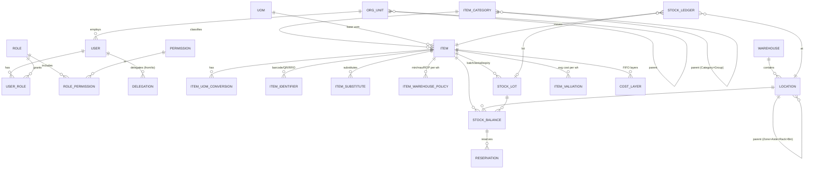
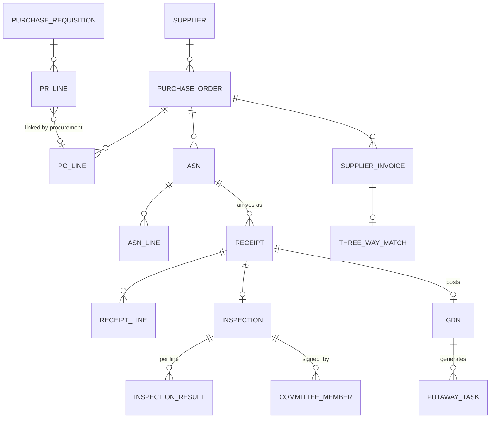
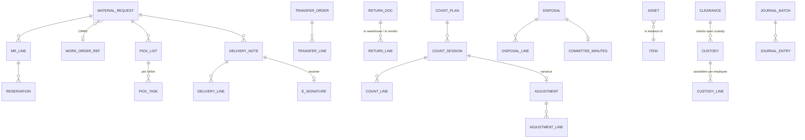
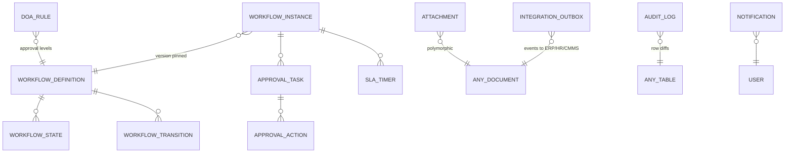
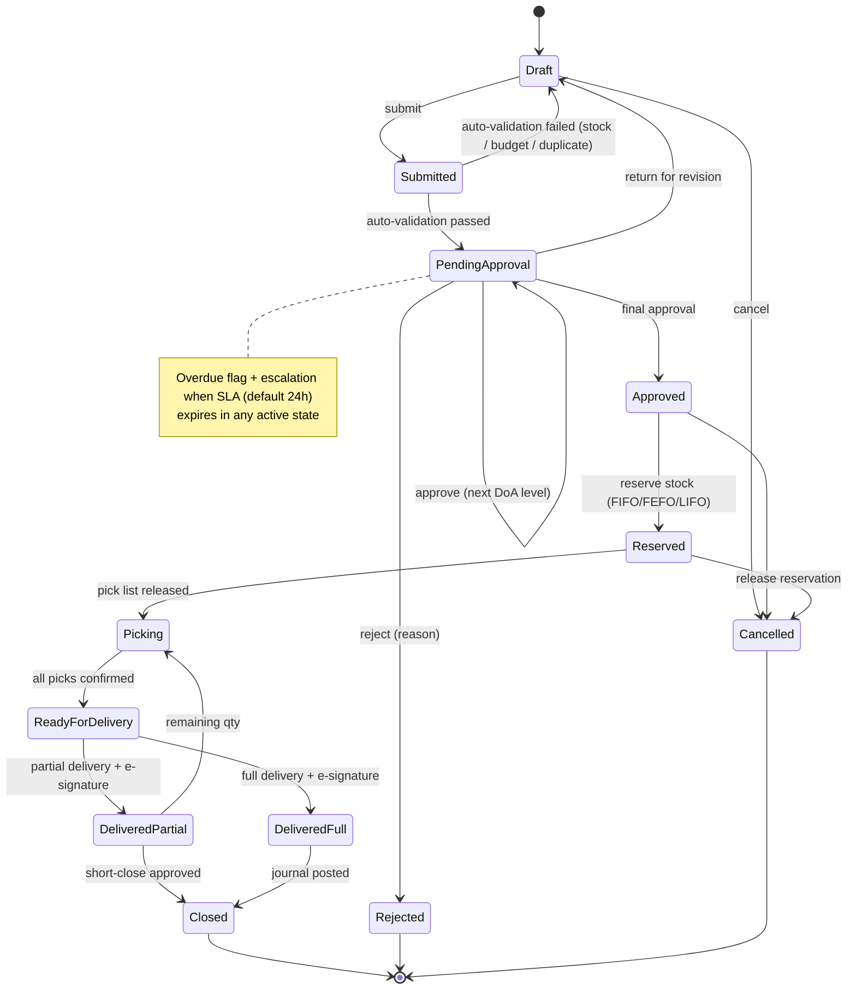
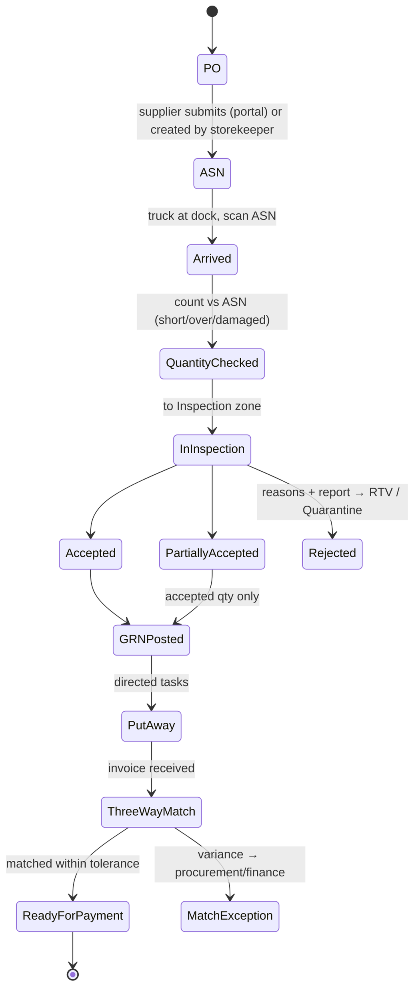

# IARDA Warehouse Management & Inventory Control System — Design for approval

> Status: **Approved** (25 Nov 2026, with the proposed defaults in §8) · Phase 1 delivered — see `02-phase1.md`
> Brand: follows `brand/` (IARDA identity) · Language: Arabic RTL default, English toggle

This document contains the three items requested before coding:

1. **Data model** (ERD + entity catalogue + inventory invariants)
2. **Role–permission matrix** (14 roles, segregation-of-duties rules, DoA matrix)
3. **Screen list** (web, mobile/PWA, supplier portal)

It also states the architecture, workflow design, and phase plan, so that each later phase can be confirmed against it.

---

## 0. Architecture summary

| Layer | Choice | Why |
|---|---|---|
| Database | **PostgreSQL 16** | Transactional integrity, row locks for stock posting, CHECK constraints, triggers for the immutable audit trail, JSONB for configurable workflows, partitioning for the ledger/audit tables |
| API | **Node.js 22 + TypeScript + Fastify**, OpenAPI 3 generated from schemas | Fast, typed, open REST API (NFR); same language across the stack |
| Data access | **Plain SQL migrations + `pg`** (parameterised queries, Zod-validated inputs) — *changed from Prisma during Phase 1* | Full control of triggers, constraints and grants; no engine binaries to download in restricted networks; DB-level guarantees cannot be bypassed by application bugs |
| Jobs | **BullMQ on Redis**: SLA escalation, scheduled reports, notifications, integration outbox, nightly ABC/XYZ & forecasts | Reliable retries, cron-style schedules |
| Web app | **React 18 + Vite + TypeScript**, TanStack Router/Query, React Hook Form + Zod, i18next | Shared Zod schemas with the API; RTL-first via the IARDA theme (`brand/css/iarda.css`) |
| Mobile | Same app as an installable **PWA** with `/m/*` task screens; camera scanning via `BarcodeDetector` + ZXing fallback; offline queue for scans | No separate app store deployment; works on Android/iOS browsers and rugged scanners (keyboard-wedge) |
| Reports | Existing `reports/` exporter (PDF/PPTX/XLSX in IARDA template) | Already built and branded |
| Auth | Local accounts (argon2id + TOTP MFA) **and** SSO via OIDC (Azure AD) / LDAP (on-prem AD) | NCA ECC identity controls |
| Deployment | Docker Compose (api, web, worker, postgres, redis); runnable on-prem or Saudi gov cloud | Data residency (PDPL) |

```
apps/
  api/        Fastify REST API, domain services, workflow engine, posting engine
  web/        React SPA + PWA (desktop + /m mobile + /portal supplier)
  worker/     BullMQ processors (SLA, notifications, schedules, integrations)
packages/
  shared/     Zod schemas, permission keys, enums, state machines, i18n keys
  reports/    → existing IARDA exporter (moved from /reports)
  (db)        SQL migrations + seed live in apps/api/src/db and apps/api/seed
```

---

## 1. Data model

### 1.1 Core design principles (non-negotiable invariants)

| # | Rule | How it is enforced |
|---|---|---|
| I-1 | **Quantities change only through posted transactions.** | `stock_balance` has no write API. Only the *posting engine* writes it, in the same DB transaction as an immutable `stock_ledger` row. DB role used by the API has no UPDATE on `stock_balance` except through the `post_stock_movement()` function. |
| I-2 | **No negative stock.** | `CHECK (qty_on_hand >= 0 AND qty_reserved >= 0 AND qty_reserved <= qty_on_hand)` on `stock_balance` + `SELECT … FOR UPDATE` row locking during posting. Violations abort the whole document posting. |
| I-3 | **Immutable ledger.** | `stock_ledger`, `audit_log`, `journal_entry` (posted) reject UPDATE/DELETE via trigger. Corrections are reversal entries. |
| I-4 | **Full audit trail** (who/what/when/old/new). | Generic row-level trigger on every business table writes `audit_log` with `old_values`, `new_values` (JSONB), actor (`SET LOCAL app.user_id`), IP, request id; **SHA-256 hash chain** (`prev_hash`) makes tampering detectable. |
| I-5 | **Soft delete only.** | `deleted_at/deleted_by` on master data; documents are never deleted — only `cancelled`. Hard DELETE revoked from the app DB role. |
| I-6 | **Segregation of duties per document.** | Checked at every workflow transition against the document's action history (not just roles), because one person may hold several roles. |
| I-7 | **Base UoM storage.** | All ledger/balance quantities stored in the item's base UoM (`numeric(18,4)`); transaction UoM + factor kept on the line for traceability. |
| I-8 | **Money** in SAR `numeric(18,2)`; unit costs `numeric(18,6)`. Dates stored UTC (`timestamptz`); Hijri (Umm al-Qura) rendered in UI/reports. |

Every business table also carries: `id (uuid v7)`, `created_at/by`, `updated_at/by`, `version` (optimistic locking), and where relevant `org_unit_id` for data scoping.

### 1.2 ERD — overview by domain









### 1.3 Entity catalogue (key fields)

**Organisation & security**

| Entity | Key fields |
|---|---|
| `org_unit` | code, name_ar/en, type (department/section/cost_center), parent_id, cost_center_code, annual_budget, budget_used |
| `user` | employee_no, name_ar/en, email, mobile (encrypted), org_unit_id, position, manager_id, auth_provider (local/oidc/ldap), mfa_enabled, status, last_login |
| `role` / `permission` / `role_permission` | permission key e.g. `mr.approve`; scope (`own`, `department`, `warehouse`, `all`) |
| `user_role` | user_id, role_id, **scope_warehouse_ids[]**, **scope_org_unit_ids[]**, valid_from/to |
| `delegation` | from_user, to_user, role_id (optional), doc_types[], max_value, valid_from/to (time-bound), reason, approved_by |
| `supplier` / `supplier_user` | CR no., VAT no., Etimad vendor id, contacts; portal users scoped to one supplier |

**Item master**

| Entity | Key fields |
|---|---|
| `item_category` | code, name_ar/en, level (category/group), parent_id, gl_inventory_account, gl_expense_account, default_valuation |
| `item` | **item_code (unique)**, name_ar/en, normalized_name (for duplicate detection), description, specs (JSONB), category_id (group level), item_type (`stock`/`non_stock`/`consumable`/`asset`), base_uom_id, track_batch, track_serial, track_expiry, shelf_life_days, weight/volume per base unit, hazard_class, storage_conditions, abc/xyz/ved class + computed_at, criticality, status (draft/active/blocked/obsolete), images |
| `item_uom_conversion` | item_id, uom_id, factor_to_base, is_purchase/issue default |
| `item_identifier` | type (barcode EAN/Code128, QR, RFID EPC, manufacturer part no.), value (unique per type) |
| `item_substitute` | item_id, substitute_item_id, ratio, priority |
| `item_warehouse_policy` | item, warehouse, min, max, reorder_point, safety_stock, reorder_qty/EOQ, lead_time_days, preferred_bin, picking_rule override |
| `item_duplicate_candidate` | new item vs existing, similarity score (trigram on Arabic-normalised name + specs + MPN) |

**Warehouse structure**

| Entity | Key fields |
|---|---|
| `warehouse` | code, name_ar/en, type (central/site/spare-parts), address, geo, manager_user_id, default_picking_rule (FIFO/FEFO/LIFO), is_active |
| `location` | warehouse_id, parent_id, **level** (zone/aisle/rack/bin), code (full path e.g. `WH01-STR-A03-R02-B05`), **zone_type** (receiving/inspection/storage/quarantine/picking/returns/damaged), max_weight_kg, max_volume_m3, current_weight/volume (maintained by posting engine), velocity_class, temperature_controlled, hazmat_allowed, mixing_allowed (items/lots), barcode, is_blocked |

**Inventory core**

| Entity | Key fields |
|---|---|
| `stock_lot` | item_id, lot_no / serial_no, mfg_date, expiry_date, supplier_id, grn_id, status (released/quarantine/expired/damaged) |
| `stock_balance` | item_id, location_id, lot_id, **stock_status** (available/quarantine/in_transit/damaged/inspection), qty_on_hand, qty_reserved → `CHECK >= 0` |
| `stock_ledger` (append-only, partitioned by month) | posting_date, doc_type, doc_id, doc_line_id, movement_type (GR, GI, TR-OUT, TR-IN, ADJ+, ADJ-, RTV, RTW, SCRAP, STATUS-CHG …), item, location, lot, qty (signed, base UoM), unit_cost, value, balance_after, avg_cost_after, posted_by, reversal_of |
| `reservation` | request line → balance (item/location/lot), qty, expires_at, status |
| `item_valuation` | item, warehouse, method (WAVG/FIFO), qty, total_value, avg_cost |
| `cost_layer` | item, warehouse, receipt ledger id, qty_remaining, unit_cost (FIFO only) |

**Inbound**

| Entity | Key fields |
|---|---|
| `purchase_order` / `po_line` | ERP PO no., **Etimad reference**, supplier, currency SAR, lines: item, qty, uom, unit_price, VAT, delivery date, qty_received, qty_invoiced |
| `asn` / `asn_line` | supplier-submitted; expected date, vehicle, lots/serials/expiry per line |
| `receipt` / `receipt_line` | status (arrived → qty_checked → in_inspection → accepted/partially/rejected → grn_posted), dock, qty_expected/received/short/over/damaged |
| `inspection` / `inspection_result` | committee (≥3 members), per line accepted_qty, rejected_qty, reason codes, test results, **mandatory inspection report attachment** |
| `grn` | number, posted_at, total value, journal batch |
| `putaway_task` | grn line, suggested_location, scanned_location, qty, assigned_to, status, score breakdown |
| `supplier_invoice` / `three_way_match` | invoice no., VAT, lines; match status (matched/qty_variance/price_variance) with tolerance % |

**Outbound & requests**

| Entity | Key fields |
|---|---|
| `material_request` | **request_type** (issue / urgent / work_order / custody / reservation), requester, org_unit, warehouse, priority, needed_by, justification (mandatory for urgent), work_order_ref, status (state machine §2.4), total_estimated_value, sla_due_at |
| `mr_line` | item, qty_requested/approved/reserved/issued, uom, substitute_allowed, cost_center |
| `pick_list` / `pick_task` | rule (FIFO/FEFO/LIFO), sequence (path-optimised by location code), lot, from_location, qty, picker, scanned confirmations |
| `delivery_note` / `delivery_line` | full/partial, **e-signature** (receiver drawn signature image + hash + timestamp + device), receiver identity check |
| `transfer_order` / `transfer_line` | type (inter-warehouse / bin-to-bin), from/to, status (draft→approved→picked→**in_transit**→received), discrepancy on receipt |
| `return_doc` / `return_line` | type (return-to-warehouse / return-to-vendor), reason, condition (good/quarantine/damaged), RTV credit note ref |

**Counting, adjustment, disposal**

| Entity | Key fields |
|---|---|
| `count_plan` | type (annual / cycle-ABC / surprise), frequency per class (A monthly, B quarterly, C semi-annual — configurable), blind flag, freeze locations flag |
| `count_session` / `count_line` | assigned counters (committee), snapshot qty (hidden if blind), counted qty (1st/2nd/3rd count), variance qty/value, reason code |
| `adjustment` / `adjustment_line` | source (count/damage/found), approval via DoA, posted ledger refs |
| `disposal` / `disposal_line` | method (scrap/sell/donate/recycle), **committee minutes attachment mandatory**, recommended_by (committee), approved_by, value |

**Planning, valuation, custody**

| Entity | Key fields |
|---|---|
| `purchase_requisition` / `pr_line` | source (auto/manual), suggested qty (EOQ/max − position), needed_by, procurement status, linked PO |
| `consumption_forecast` | item, warehouse, period, method (moving avg / exponential smoothing / seasonal), forecast qty, MAD |
| `obsolescence_provision` | item, age bucket, provision % and value, period |
| `journal_batch` / `journal_entry` | period, source doc, Dr/Cr account, cost center, amount, export status (to ERP) |
| `asset` | asset_tag, item_id, serial_no, acquisition cost/date, location / custodian, status |
| `custody` / `custody_line` | employee, asset/item, qty, issued_date, return due, transfer chain |
| `clearance` | employee, reason (resignation/transfer/retirement), open custody check, HR reference, status |

**Workflow, cross-cutting**

| Entity | Key fields |
|---|---|
| `workflow_definition` | doc_type, version, states (JSONB), transitions with guards & required permissions, active_from |
| `doa_rule` | doc_type, min_value, max_value, category_ids, org_unit_ids, level, approver (role / position / specific user), parallel/sequential, SLA hours |
| `workflow_instance` / `approval_task` / `approval_action` | current state, current level, assignee (after delegation resolution), action (approve/reject/return/delegate), comment, signed_at |
| `sla_policy` / `sla_timer` | doc_type, state, hours (default 24h for MR), escalation chain |
| `attachment` | owner_type/owner_id, category (inspection_report, minutes, invoice, photo, signature), file hash (SHA-256), size, mime, virus-scan status, stored encrypted |
| `audit_log` (append-only, partitioned) | table, record_id, action, old_values, new_values, actor_user_id, on_behalf_of (delegation), ip, user_agent, request_id, at, prev_hash, hash |
| `notification` / `notification_template` | channel (in-app/email/SMS), template key, ar/en bodies, status |
| `alert_rule` | type (low stock, expiry ≤N days, overdue request, SLA breach, dead stock), thresholds, recipients |
| `scheduled_report` | report key, params, cron, format, recipients |
| `integration_outbox` / `integration_log` | event, payload, target system, status, retries |
| `number_sequence` | doc_type, prefix, fiscal year, next_no (e.g. `MR-1448-000123`) |
| `setting` | key/value (valuation method, SLA defaults, tolerances, picking rule) |

### 1.4 Posting engine (single entry point for quantity changes)

```
post(document) in ONE database transaction:
  1. lock affected stock_balance rows  (SELECT … FOR UPDATE, ordered by key to avoid deadlocks)
  2. validate: status allows posting, SoD, lots/serials/expiry, location zone rules, capacity
  3. insert stock_ledger rows (signed qty, cost per valuation method)
  4. update stock_balance  → CHECK constraint rejects any negative result
  5. update item_valuation / cost_layer, location current weight/volume
  6. create journal_entry rows (Dr/Cr by category GL accounts)
  7. set document status = posted; write integration_outbox event
  commit (or roll back everything)
```

---

## 2. Roles, permissions and workflows

### 2.1 Role catalogue

| Code | Role (AR / EN) | Data scope |
|---|---|---|
| ADM | مدير النظام / System Admin | system-wide config, **no stock transactions** |
| WM | مدير المستودع / Warehouse Manager | assigned warehouses |
| SK | أمين المستودع / Storekeeper | assigned warehouses |
| WW | عامل المستودع / Warehouse Worker | assigned tasks only, **mobile only** |
| MDO | مسؤول البيانات الرئيسية / Master Data Officer | all items, no transactions |
| PLN | مخطط المخزون / Inventory Planner | assigned warehouses/categories |
| REQ | طالب المواد / Requester | **own** requests |
| DM | مدير الإدارة / Department Manager | **own department** |
| IRC | لجنة الفحص والاستلام / Inspection & Receiving Committee | assigned inspections |
| CDC | لجنة الجرد والإتلاف / Count & Disposal Committee | assigned counts/disposals |
| PRC | المشتريات / Procurement | requisitions, POs |
| FIN | المالية / Finance | valuation & journals; read-only transactions |
| AUD | المراجع الداخلي / Internal Auditor | read-only everything + audit trail |
| SUP | المورد (بوابة خارجية) / Supplier | **own** POs/ASNs/deliveries only |

### 2.2 Role–permission matrix

Legend: **✔** full · **C** create · **A** approve · **R** read · **O** own records only · **D** own department · **M** mobile execution only · **–** none

| Permission | ADM | WM | SK | WW | MDO | PLN | REQ | DM | IRC | CDC | PRC | FIN | AUD | SUP |
|---|---|---|---|---|---|---|---|---|---|---|---|---|---|---|
| **Administration** |
| Users, roles, delegations admin | ✔ | – | – | – | – | – | – | – | – | – | – | – | R | – |
| Settings, workflows, DoA matrix | ✔ | R | – | – | – | – | – | – | – | – | – | R | R | – |
| Own delegation (absence) | – | C | – | – | – | – | – | C | C | C | – | C | – | – |
| **Master data** |
| Items: create / edit / block | – | R | R | – | ✔ | R (+ policy fields) | R | R | R | R | R | R | R | – |
| New Item Creation request | – | C | C | – | ✔ | C | C | C | – | – | C | – | R | – |
| Approve new item / duplicates | – | A | – | – | – | – | – | – | – | – | – | – | R | – |
| Warehouse structure (zones→bins) | ✔ | ✔ | R | – | – | R | – | – | – | – | – | – | R | – |
| Suppliers | ✔ | R | R | – | – | R | – | – | – | – | ✔ | R | R | O |
| **Inbound** |
| Purchase orders (sync/view) | – | R | R | – | – | R | – | – | R | – | ✔ | R | R | O |
| ASN | – | R | R | – | – | – | – | – | R | – | R | – | R | C/O |
| Receive (arrival, qty check) | – | R | ✔ | M | – | – | – | – | R | – | R | – | R | – |
| Technical inspection accept/reject | – | R | – | – | – | – | – | – | ✔ | – | R | – | R | – |
| Post GRN | – | A | C | – | – | – | – | – | – | – | – | R | R | – |
| Put-away (directed) | – | R | ✔ | M | – | – | – | – | – | – | – | – | R | – |
| Invoices / 3-way match | – | R | – | – | – | – | – | – | – | – | C | ✔ | R | O (status) |
| **Outbound & requests** |
| Material / urgent / custody / reservation request | – | C | C | – | – | – | C/O | C/D | – | – | – | – | R | – |
| Work-order issue request | – | C | C | – | – | – | C/O | C/D | – | – | – | – | R | – |
| Approve requests (within DoA/budget) | – | A | – | – | – | – | – | A/D | – | – | – | – | R | – |
| Reserve, pick list, issue, delivery | – | R | ✔ | M (pick) | – | – | – | – | – | – | – | – | R | – |
| Confirm receipt / e-signature | – | – | – | – | – | – | O | D | – | – | – | – | R | – |
| **Transfers, returns** |
| Bin-to-bin transfer | – | ✔ | ✔ | M | – | – | – | – | – | – | – | – | R | – |
| Inter-warehouse transfer request | – | C | C | – | – | C | – | – | – | – | – | – | R | – |
| Approve inter-warehouse transfer | – | A | – | – | – | – | – | – | – | – | – | – | R | – |
| Return to warehouse | – | R | ✔ | M | – | – | C/O | C/D | R | – | – | – | R | – |
| Return to vendor (RTV) | – | A | C | – | – | – | – | – | R | – | ✔ | R | R | O |
| **Counting, adjustment, disposal** |
| Count plans (create/schedule) | – | ✔ | – | – | – | C | – | – | – | R | – | R | R | – |
| Perform count (blind) | – | – | – | M | – | – | – | – | – | ✔ | – | – | R | – |
| Variance review / recount | – | ✔ | R | – | – | – | – | – | – | ✔ | – | R | R | – |
| Adjustment request | – | C | C | – | – | – | – | – | – | C (recommend) | – | – | R | – |
| Approve adjustment / post | – | A | – | – | – | – | – | – | – | – | – | R | R | – |
| Write-off / disposal recommendation | – | R | – | – | – | – | – | – | – | C | – | R | R | – |
| Approve write-off / disposal | – | A | – | – | – | – | – | – | – | – | – | A (finance review) | R | – |
| **Planning, valuation, custody** |
| Min/max, ROP, safety stock, EOQ | – | R | – | – | – | ✔ | – | – | – | – | – | R | R | – |
| Purchase requisitions (auto/manual) | – | A | – | – | – | C | – | – | – | – | R (process) | R | R | – |
| Link requisition → PO | – | – | – | – | – | – | – | – | – | – | ✔ | R | R | – |
| Valuation, provisions, period close | – | R | – | – | – | – | – | – | – | – | – | ✔ | R | – |
| Journal entries export / reconciliation | – | – | – | – | – | – | – | – | – | – | – | ✔ | R | – |
| Assets & custody issue/transfer | – | A | ✔ | – | – | – | O (view own) | D | – | – | – | R | R | – |
| Employee clearance | – | A | C | – | – | – | O | D | – | – | – | R | R | – |
| **Insight** |
| Dashboards | ✔ (system) | ✔ | ✔ | M (tasks) | ✔ (data quality) | ✔ | O | D | ✔ (inspections) | ✔ (counts) | ✔ | ✔ | ✔ | O |
| Reports & export | R | ✔ | ✔ | – | R | ✔ | O | D | R | R | R | ✔ | ✔ | O |
| **Audit trail** | R (config only) | R (own warehouse) | – | – | – | – | – | – | – | – | – | R | ✔ | – |

### 2.3 Segregation-of-duties rules (enforced per document)

| Rule | Check at transition |
|---|---|
| SoD-1 | Requester ≠ any approver of the same request |
| SoD-2 | Approver ≠ issuer (storekeeper who posts the issue) |
| SoD-3 | Adjustment creator/counter ≠ adjustment approver ≠ adjustment poster |
| SoD-4 | Receiver (storekeeper) ≠ inspection committee member on the same receipt |
| SoD-5 | Count & Disposal committee can **recommend** only; balance changes require WM approval + posting |
| SoD-6 | New item requester ≠ item approver; MDO cannot post any transaction |
| SoD-7 | Delegation cannot delegate to the requester of the document or to someone already acting on it |
| SoD-8 | Supplier users see only their supplier's records (row-level filter) |

### 2.4 Delegation of Authority (seeded defaults — fully configurable)

| Document | Value (SAR) | Approval chain |
|---|---|---|
| Material issue request | ≤ 5,000 | Department Manager |
| | 5,001 – 50,000 | Department Manager → Warehouse Manager |
| | > 50,000 | Department Manager → Warehouse Manager → Executive approver (named user) |
| Urgent issue | any | Single approver: Department Manager **or** WM (first to act); mandatory justification; post-facto review flag |
| Critical-category items (e.g. fire safety, fuel) | any | + Warehouse Manager regardless of value |
| Inter-warehouse transfer | any | Warehouse Manager (source) |
| Count adjustment | ≤ 10,000 | Warehouse Manager |
| | > 10,000 | Warehouse Manager → Finance |
| Write-off / disposal | any | Committee recommendation → WM → Finance → Executive (> 25,000) |
| Purchase requisition | auto / manual | Planner → Warehouse Manager |
| New item | — | Master Data Officer prepares → Warehouse Manager approves |

### 2.5 Material Issue Request state machine



### 2.6 Receiving lifecycle



### 2.7 Request types → workflow

| Request type | Workflow | Special rules |
|---|---|---|
| Material Issue Request | §2.5 | DoA by value/category/department; budget check |
| Urgent Issue Request | §2.5 short path | single approver, justification mandatory, SLA 4h |
| Work Order Issue | §2.5 | must reference CMMS work order; cost to WO |
| Custody Request | §2.5 + custody record on delivery | asset-type items; employee signature |
| Stock Reservation | Draft → Approved → Reserved → Released/Consumed | expiry date on reservation |
| Return to Warehouse | Draft → Received → Inspected (condition) → Posted | condition decides zone (storage/quarantine/damaged) |
| Inter-Warehouse Transfer | Draft → Approved → Picked → In-Transit → Received → Closed | discrepancy report on receipt |
| Purchase Requisition | Draft/Auto → Approved → Sent to Procurement → Linked to PO → Closed | Etimad reference captured |
| Return to Vendor | Draft → Approved → Shipped → Credit note → Closed | from rejected inspection or quarantine |
| Count Adjustment | Count → Variance → Recount → Recommended → Approved → Posted | approval by value |
| Write-off / Disposal | Recommended (committee + minutes) → WM → Finance → (Executive) → Posted | minutes attachment mandatory |
| New Item Creation | Draft → Duplicate check → MDO review → WM approval → Active | duplicate score shown |
| Employee Clearance | Requested (HR) → Custody check → Returns received → Cleared | blocks if open custody |

### 2.8 KPIs (dashboard widgets)

| KPI | Target | Formula |
|---|---|---|
| Inventory accuracy | ≥ 98% | lines counted with no variance (within tolerance) ÷ lines counted |
| Fill rate | ≥ 95% | qty delivered on first issue ÷ qty approved |
| Request cycle time | ≤ 24 h | median(approved→delivered) and (submitted→delivered) |
| Dock-to-stock | ≤ 48 h | arrived → put-away completed |
| Inventory turnover | by category | COGS issued (12m) ÷ average inventory value |
| Dead stock | ≤ 10% | value with no movement > 12 months ÷ total value |
| Stock-outs on critical items | = 0 | count of critical (VED = V) items with available = 0 |
| Space utilisation | 75–85% | occupied volume ÷ storage-zone capacity |

---

## 3. Screen list

Platform: **W** = web (desktop/tablet), **M** = mobile PWA task screen, **P** = supplier portal.

### 3.1 Common

| # | Screen (AR / EN) | Platform | Roles |
|---|---|---|---|
| C1 | تسجيل الدخول / Login (local + SSO + MFA) | W M P | all |
| C2 | لوحة المعلومات حسب الدور / Role dashboard | W | all (widgets per role) |
| C3 | صندوق المهام والموافقات / My tasks & approvals inbox | W M | approvers, committees, SK, WW |
| C4 | الإشعارات والتنبيهات / Notifications & alerts | W M | all |
| C5 | البحث الشامل / Global search (items, documents, bins, serials) | W | internal roles |
| C6 | ملفي والتفويض / My profile & absence delegation | W | approvers |

### 3.2 Administration

| # | Screen | Platform | Roles |
|---|---|---|---|
| A1 | Users (list, detail, roles & scopes) | W | ADM |
| A2 | Roles & permission matrix editor | W | ADM |
| A3 | Workflow definitions (states/transitions, versioning) | W | ADM |
| A4 | DoA matrix editor | W | ADM |
| A5 | SLA & escalation policies | W | ADM |
| A6 | Delegations register | W | ADM, AUD |
| A7 | System settings (valuation, picking rule, tolerances, numbering, Hijri/Gregorian) | W | ADM |
| A8 | Notification templates (AR/EN, email/SMS) | W | ADM |
| A9 | Integrations & API clients (keys, logs, outbox) | W | ADM |
| A10 | Audit trail explorer (record history, diff view, hash-chain verification) | W | AUD, ADM(R) |

### 3.3 Master data

| # | Screen | Platform | Roles |
|---|---|---|---|
| D1 | Item catalogue (search, filters, classes, stock by warehouse) | W | all internal |
| D2 | Item detail (tabs: general, UoM, identifiers, specs, images, substitutes, policies, stock, ledger, audit) | W | MDO edit; others read |
| D3 | New item request + duplicate check | W | MDO, WM, SK, PLN, REQ, DM, PRC |
| D4 | Category / group tree | W | MDO |
| D5 | Units of measure & conversions | W | MDO |
| D6 | Label & barcode printing (items, bins, lots) | W | MDO, SK |
| D7 | Suppliers | W | PRC, ADM |
| D8 | Warehouse structure tree (warehouse → zone → aisle → rack → bin) + capacity heat-map | W | WM, ADM |

### 3.4 Inbound & put-away

| # | Screen | Platform | Roles |
|---|---|---|---|
| I1 | Purchase orders (from ERP, Etimad ref) | W | PRC, SK, WM |
| I2 | ASN list & detail | W P | SK, SUP |
| I3 | Dock arrival / receiving | W M | SK, WW |
| I4 | Quantity check (scan lines, lots, serials, expiry) | M W | SK, WW |
| I5 | Technical inspection (committee, per-line accept/reject, reasons, report upload) | W | IRC |
| I6 | GRN (review, post, print) | W | SK, WM |
| I7 | Put-away tasks (suggested bin, scan-to-confirm) | M | SK, WW |
| I8 | Supplier invoices & 3-way match | W | FIN, PRC |

### 3.5 Outbound & requests

| # | Screen | Platform | Roles |
|---|---|---|---|
| O1 | New request wizard (issue / urgent / work-order / custody / reservation) with live stock & budget | W M | REQ, DM, SK, WM |
| O2 | My requests (track status timeline) | W M | REQ, DM |
| O3 | Request detail & approval (DoA chain, attachments, history) | W M | approvers |
| O4 | Reservation & pick-list release | W | SK |
| O5 | Picking (scan bin → scan item/lot → qty) | M | WW, SK |
| O6 | Delivery & e-signature (full/partial) + delivery note print | W M | SK |
| O7 | Overdue / SLA monitor | W | WM |

### 3.6 Transfers & returns

| # | Screen | Platform | Roles |
|---|---|---|---|
| T1 | Bin-to-bin transfer (scan) | M W | SK, WW |
| T2 | Inter-warehouse transfer (request, approve, ship, in-transit, receive) | W M | SK, WM, PLN |
| R1 | Return to warehouse (condition assessment) | W M | SK, REQ |
| R2 | Return to vendor | W | SK, PRC, WM |
| R3 | Quarantine management (release / reject / dispose) | W | WM, IRC |

### 3.7 Counting, adjustment, disposal

| # | Screen | Platform | Roles |
|---|---|---|---|
| S1 | Count plans & calendar (annual / ABC cycle / surprise) | W | WM, PLN |
| S2 | Count execution — blind scan count | M | CDC, WW |
| S3 | Variance review & recount | W | WM, CDC |
| S4 | Adjustments (request, approve, post) | W | WM, SK, CDC |
| S5 | Write-off / disposal (committee minutes, approvals) | W | CDC, WM, FIN |

### 3.8 Planning, valuation, custody

| # | Screen | Platform | Roles |
|---|---|---|---|
| L1 | Replenishment workbench (below ROP, suggested qty, EOQ) | W | PLN |
| L2 | Stock policies (min/max/ROP/safety per item-warehouse; bulk edit) | W | PLN |
| L3 | Consumption forecast | W | PLN |
| L4 | Purchase requisitions (auto/manual, link to PO) | W | PLN, PRC, WM |
| L5 | Slow-moving & dead stock | W | PLN, WM, FIN |
| L6 | ABC / XYZ / VED classification run | W | PLN |
| V1 | Stock valuation (by warehouse/category, as-of date) | W | FIN, WM |
| V2 | Obsolescence provision | W | FIN |
| V3 | Journal entries & export batches, reconciliation | W | FIN |
| K1 | Assets register | W | SK, WM, FIN |
| K2 | Employee custody (issue, transfer, return) | W | SK, WM |
| K3 | My custody | W M | REQ (own), DM (dept) |
| K4 | Employee clearance | W | SK, WM, DM |

### 3.9 Reports (all exportable to PDF / Excel in the IARDA template)

Stock on hand (by warehouse/zone/bin/lot) · Stock ledger (item card) · Movement summary · Expiry report · GRN register · Issues by department / cost center / work order · Request SLA report · Count variance report · Adjustments & write-offs register · Valuation report · Dead & slow-moving · Custody by employee · Supplier delivery performance · KPI scorecard. Scheduled delivery by email.

### 3.10 Mobile PWA (`/m`) — warehouse-floor screens

Home (my tasks) · Scan anything (item / bin / lot / serial / document) · Receive · Put-away · Pick · Bin-to-bin move · Blind count · Transfer receive · Item lookup (stock by bin) · Deliver with signature. Large touch targets, camera + hardware scanner input, offline queue with sync status.

### 3.11 Supplier portal (`/portal`)

Login · My POs · Submit ASN (lines, lots, serials, expiry, delivery slot) · Delivery status (received / inspected / rejected reasons) · Invoice status.

---

## 4. Integrations (REST + stubs)

| System | Direction | Endpoints / events |
|---|---|---|
| ERP / Finance | out: journals, GRN, valuation; in: GL accounts, cost centers, budgets | `POST /integrations/erp/journals`, `GET /integrations/erp/budgets/:costCenter` |
| Procurement / Etimad | in: POs (+Etimad ref); out: PRs, GRN, 3-way match | `POST /integrations/procurement/purchase-orders`, `GET /purchase-requisitions?status=approved` |
| CMMS / CAFM | in: work orders; out: issued materials per WO | `POST /integrations/cmms/work-orders`, event `mr.delivered` |
| HR | in: employees, org units, terminations; out: clearance status | `POST /integrations/hr/employees`, `GET /clearances/:employeeNo` |
| SSO | OIDC (Azure AD), LDAP bind (AD) | `/auth/oidc/callback`, `/auth/ldap` |
| Email / SMS | out | SMTP + SMS gateway adapter (stub provider) |
| Printers / scanners | out: ZPL labels; in: keyboard-wedge / camera | `POST /labels/print` (ZPL/PDF), scanner input handled client-side |

All inbound integrations use API clients with scoped keys/OAuth client credentials, idempotency keys, and the outbox pattern for outbound events.

## 5. Security & compliance (NCA ECC / PDPL)

- **Authentication:** argon2id password hashing, TOTP MFA (mandatory for privileged roles), SSO, account lockout, session timeout, and refresh-token rotation.
- **Authorisation:** RBAC with data-scope filters applied server-side (warehouse, department, own, supplier).
- **Encryption:** TLS 1.2+ everywhere and an encrypted disk/volume for the database. Personal fields (mobile, national ID) and attachments are encrypted at the application level with AES-256-GCM.
- **PDPL:** each personal field is tagged with its data classification, personal-data access is logged, and retention policies are enforced through soft delete with anonymisation after the retention period.
- **Audit:** an append-only, hash-chained audit trail with a verification tool, plus security logs exportable to a SIEM.
- **Backups:** daily full `pg_dump` plus WAL archiving (point-in-time recovery), encrypted, with a documented restore test.
- **Application security:** input validation (Zod), rate limiting, CSP/HSTS headers, file-type and size checks on uploads, and dependency scanning.

## 6. Demo seed data

- **Warehouses (5):**
  - مستودع قطع الغيار (SPR): spare parts, FIFO.
  - مستودع مستهلكات النظافة (CLN): cleaning consumables, FEFO.
  - مستودع مستهلكات الضيافة (HSP): hospitality consumables, FEFO.
  - مستودع الهالك (SCR): scrap and items awaiting disposal.
  - مستودع الأصول (AST): assets (IT, furniture, safety and field equipment), serial-tracked.
- **Warehouse structure:** each warehouse has Receiving, Inspection, Storage, Quarantine, Picking, الرجيع (returns) and Damaged zones, broken down into aisles, racks and bins.
- **Items:** 200 items with Arabic names in 8 categories:
  - مواد النظافة (cleaning supplies)
  - مستهلكات الضيافة (hospitality consumables)
  - قطع غيار المعدات والمرافق (equipment and facility spare parts: generators, HVAC, plumbing, tools)
  - المواد الكهربائية (electrical materials)
  - معدات السلامة (safety equipment)
  - معدات التخييم والجوالة (camping and ranger equipment)
  - الأجهزة التقنية (IT equipment)
  - الأثاث (furniture)
- **Item variety:** batches, serials (IT and assets), expiry dates (cleaning and hospitality consumables), and multiple units of measure (كرتون / علبة / حبة: carton / box / piece).
- **Transaction history:** 12 months of realistic transactions (GRNs, issues, transfers, counts), so the KPIs, ABC/XYZ classes, forecasts and dead-stock reports have data to work with.
- **Users:** 28 demo users (system administrator: عبدالعزيز محمد القحطاني) covering all 14 roles, across 6 departments.
- **Supporting records:** suppliers with portal users, POs with Etimad references, and open requests in every state of the request lifecycle.

## 7. Phase plan (each phase ends with a demo and your confirmation)

| Phase | Deliverables | Done when |
|---|---|---|
| **1** | Monorepo, DB schema + migrations (all invariants, audit triggers), auth (local + MFA + OIDC stub), RBAC & scopes, app shell (AR/EN, IARDA theme), Item Master (incl. duplicate detection, UoM, identifiers, images), Warehouse Structure, seed for users/items/warehouses, API docs | Users of each role log in and see only what the matrix allows; items/bins CRUD with full audit trail; tests green |
| **2** | Posting engine, Inbound (PO, ASN, receiving, inspection, GRN, labels), Put-away suggestions + mobile scanning, Outbound (requests, DoA approvals, delegation, reservation, picking rules, delivery + e-signature), SLA escalation | MR and receiving lifecycles run end-to-end; negative stock impossible (tested) |
| **3** | Transfers (in-transit), Returns/RTV/quarantine, Stock counting (annual/cycle/surprise/blind), variance & approved adjustments, Write-off/disposal with minutes | Count → adjustment → ledger with approvals and SoD enforced |
| **4** | Planning (min/max, ROP, safety, EOQ, forecast, auto-PR, dead stock), Valuation (WAVG/FIFO, provisions, journals), Assets & custody, clearance | Valuation reconciles to ledger; auto-PRs generated from policies |
| **5** | Role dashboards + KPI widgets with targets, reports & scheduled reports (PDF/Excel in IARDA template), alerts & notifications, integration endpoints + stubs, supplier portal, backups & hardening | KPIs computed from seeded history; integration stubs documented in OpenAPI |

## 8. Decisions needed before Phase 1

| # | Decision | Proposed default |
|---|---|---|
| 1 | Tech stack in §0 | Approve as proposed |
| 2 | Default valuation method | Weighted average per warehouse (FIFO selectable per category) |
| 3 | Default picking rule | FEFO for expiry-tracked items, FIFO otherwise |
| 4 | Executive approver for high-value DoA levels | A named user/position configured in the DoA matrix (no extra role) |
| 5 | Document numbering | `{TYPE}-{HijriYear}-{seq}` e.g. `MR-1448-000123` |
| 6 | Primary date display | Hijri first, Gregorian second |
| 7 | Count tolerance & 3-way-match tolerance | ±0% count for A items, ±2% B/C; 3-way match ±2% qty, ±1% price |
| 8 | Budget source | ERP integration stub with local budget table for demo |
