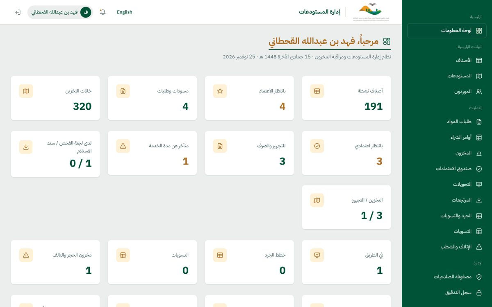
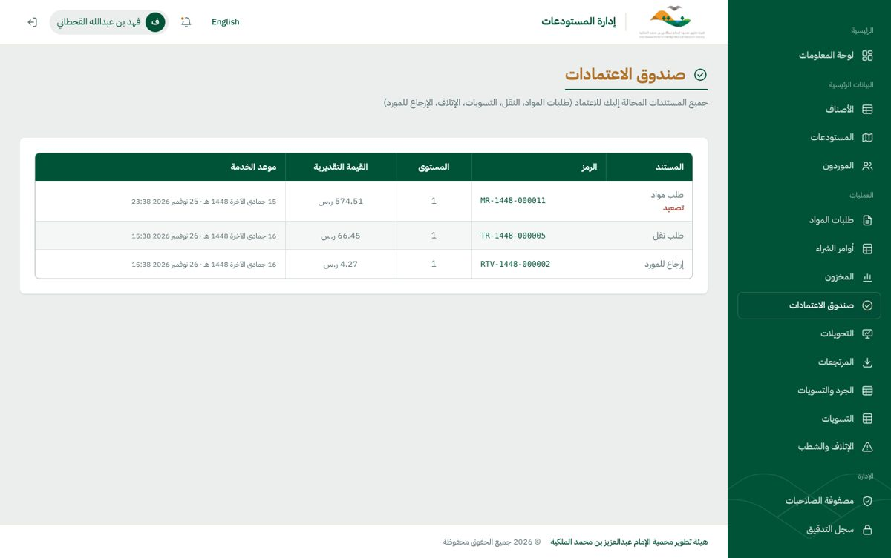
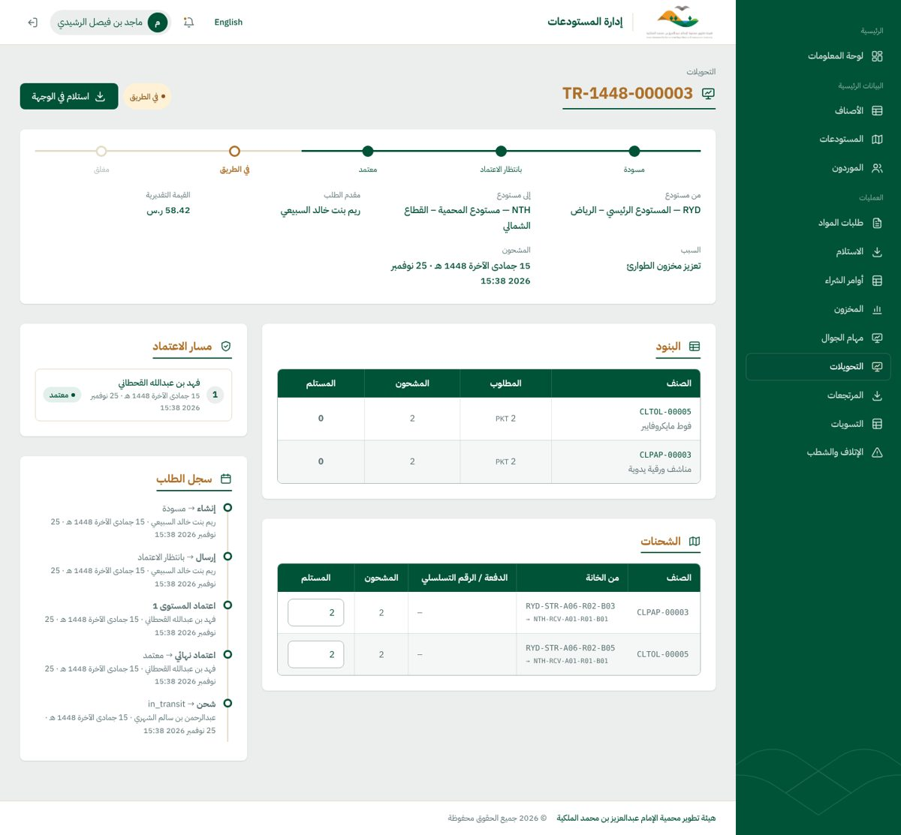
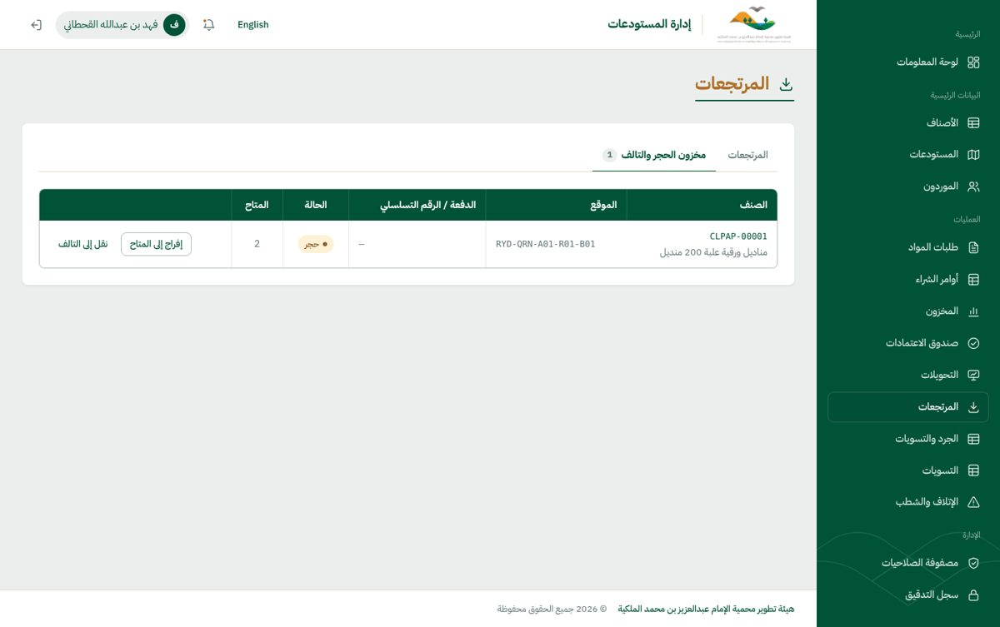
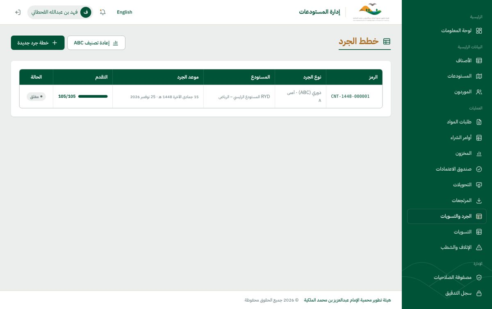
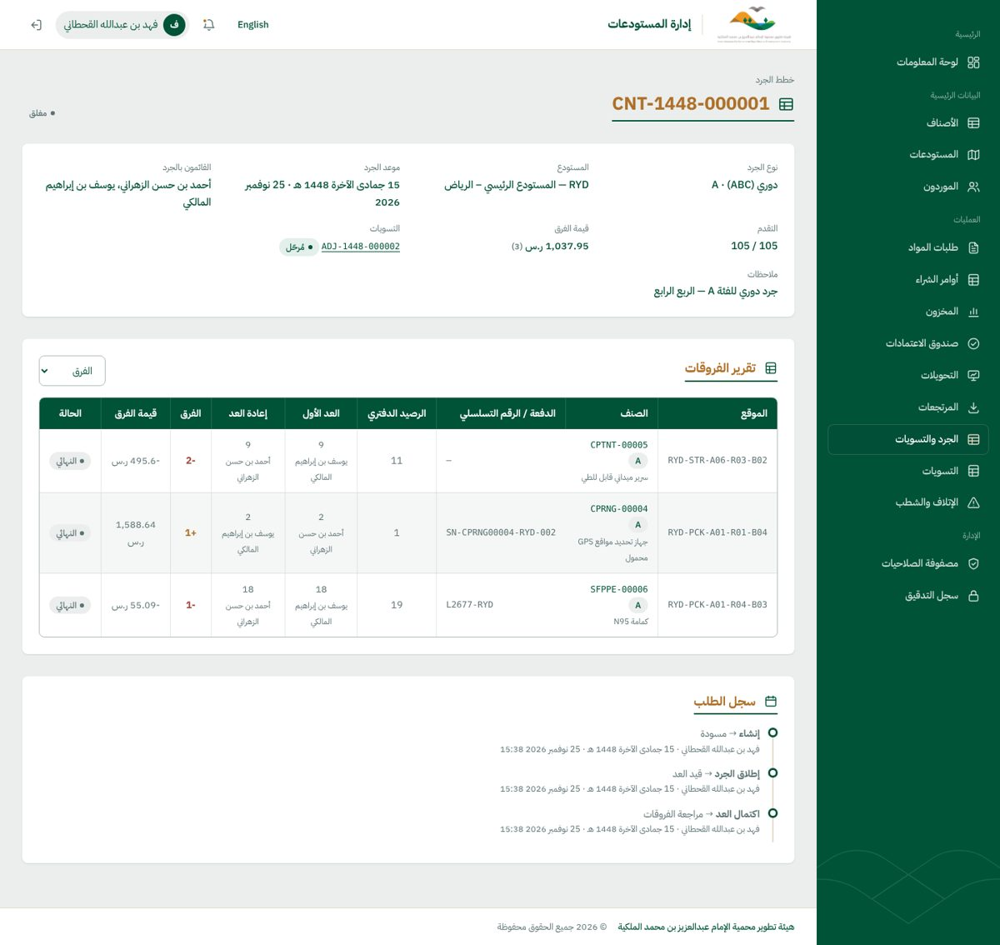
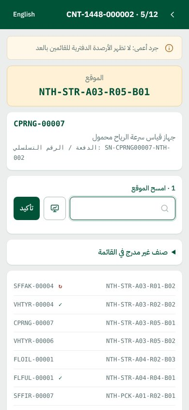
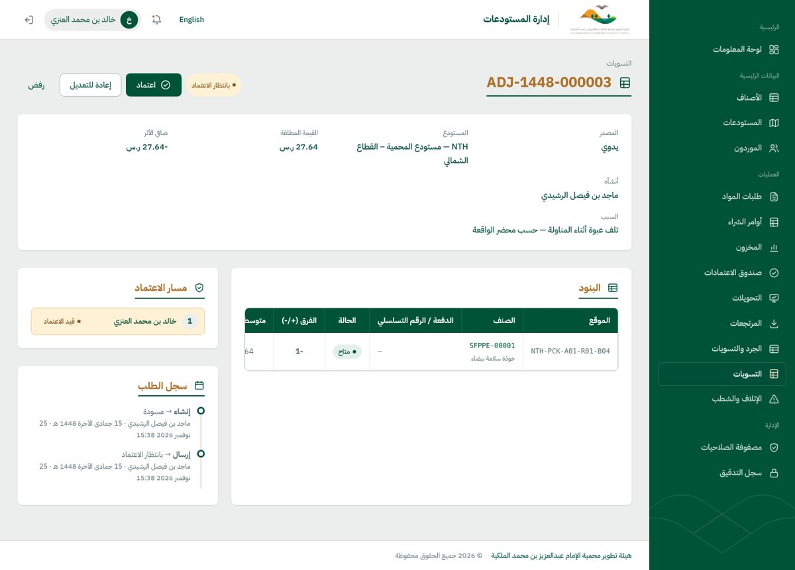
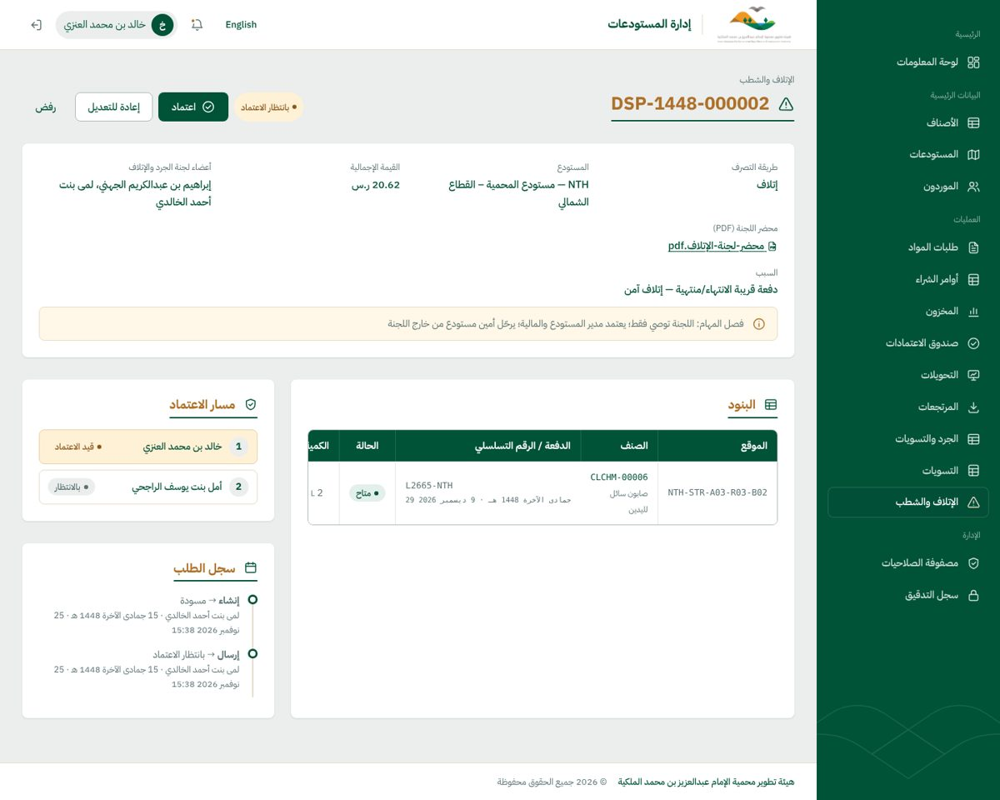

# WMS Phase 3: Transfers, الرجيع (Returns), Counting (الجرد) & Disposal

Status: **delivered, awaiting confirmation** before Phase 4 (planning, replenishment, valuation and journals, reports).

## What is included

### Unified approvals inbox

- **One generic DoA lifecycle** for four document types: transfers (TR), adjustments (ADJ), disposals (DSP) and returns to vendor (RTV). It uses the same `doa_rule` and `approval_task` machinery as material requests, so delegation, SLA and escalation all apply.
- **`/approvals`** lists every task assigned to the user across all document types, including material requests.
- **Reject and return** both require a reason.
- **When no other approver exists**, the SoD exclusion falls back to another holder of the same role. For example, a variance raised by the consumables warehouse manager is approved by the assets warehouse manager. It never falls back to the requester.

Seeded DoA matrix (configurable in `doa_rule`):

| Document | Level 1 | Level 2 | Level 3 |
|---|---|---|---|
| Transfer | Source warehouse manager | — | — |
| Adjustment | Warehouse manager | Finance, above SAR 10,000 | — |
| Disposal | Warehouse manager | Finance | Executive approver, above SAR 25,000 |
| Return to vendor | Warehouse manager | — | — |

### Inter-warehouse transfers (with an In-Transit status)

**Lifecycle:** Draft → Pending approval (source warehouse manager) → Approved → **In transit** → Received → Closed.

- **Ship:**
  - Picks free stock at the source using the item's FEFO/FIFO/LIFO rule.
  - Posts `TR_OUT` at the source, and `TR_IN_TRANSIT` into the destination's receiving dock with status `in_transit`, at the source's average cost.
  - Stock in transit is visible, counted in the ledger, and not pickable.
- **Receive:**
  - The destination storekeeper converts in-transit stock to available and gets put-away tasks with suggested bins.
  - Quantities can be entered per shipment line.
  - **Shortfall:** the transfer goes to *Received — discrepancy pending*, the missing quantity stays in transit, and a **transit adjustment** is created automatically. When that adjustment is posted, the transfer closes.
- **SoD and scope:**
  - The approver cannot ship.
  - The shipper cannot receive.
  - Each step is limited to the user's warehouse scope.

### Bin-to-bin moves

- **Scan-validated:** the source bin, the item and the destination bin are scanned. The system checks free (unreserved) stock, capacity, compatibility and blocked bins, and keeps the move within one warehouse and the user's scope.
- **Postings:** `MOVE_OUT` / `MOVE_IN`. They are value-neutral and leave the warehouse total unchanged.
- **Available in two places:** the mobile screen `/m/move` and the API `POST /api/moves`.

### Returns, quarantine and returns to vendor

- **Return to warehouse:**
  - Any requester can raise one, optionally against a material request. A return cannot exceed what was issued on that request.
  - The storekeeper inspects the goods and books them by condition:
    - **good** → returns zone plus a put-away task
    - **quarantine** → quarantine zone
    - **damaged** → damaged zone
  - The movement is `RTW`, valued at the original issue cost.
- **Quarantine:** the warehouse manager decides to *release to available* (which creates a put-away task) or *move to damaged*. The quarantine list also shows expired lots.
- **Return to vendor (RTV):**
  - Lifecycle: approval → shipment by the storekeeper (movement `RTV`; the approver cannot ship) → credit note reference, which closes it.
  - It can be raised from quarantine, damaged or available stock.

### Stock counting

- **Count types:**
  - **Annual:** whole warehouse, or selected zones or items.
  - **Cycle by ABC:** each class has a frequency (A every 30 days, B every 90, C every 180). Only items that are due are included.
  - **Surprise:** a random sample.
- **Blind counting (the default):** counters see neither the book quantity nor a colleague's count. This is enforced by the API, not only hidden in the UI.
- **Tolerance:** set per ABC class in `count.tolerance_pct`, by default A 0%, B 2%, C 2%. A first count outside tolerance requires a **recount by a different counter** (rule COUNT-2, also enforced in the database).
- **Finishing a count:**
  - Requires all lines counted and no recounts pending.
  - Computes variances at average cost.
  - Raises an **adjustment** and routes it through DoA. With no variances, the plan closes directly.
- **Unplanned items** found in a bin can be added while counting.
- **ABC classification** (`classify_abc()`): Pareto at 80% / 95% on 12-month issue value. When consumption history is too thin, as at go-live, it falls back to stock value.

### Variance approval (inside counting and transfers)

There is no separate adjustments screen. Variances are approved and posted in a «اعتماد الفروقات» panel on the screen that raised them: the count plan or the transfer. Old `/adjustments` links open that screen. Manual adjustments are no longer offered in the UI.

- **Sources:** count variances and transit shortfalls.
- **Approval:** follows the value-based DoA (Finance above SAR 10,000).
- **SoD-3:**
  - Counters cannot approve the resulting adjustment.
  - The poster must be someone other than the creator, the approvers and the counters.
  - Finance approves but cannot post stock.
- **Posting:** `ADJ_PLUS` / `ADJ_MINUS` through the posting engine. A posting that would drive stock negative is refused and nothing changes (I-2).

### Write-off and disposal (committee minutes)

- **The count & disposal committee drafts it:** at least two CDC members, with the method (scrap, sell, donate or recycle) and the stock lines.
- **Signed minutes are mandatory:** the minutes PDF (an encrypted attachment) must be uploaded before the committee can recommend.
- **Approval:** warehouse manager → Finance → executive above SAR 25,000.
- **SoD-5:**
  - Committee members cannot approve.
  - A storekeeper outside both the committee and the approval chain posts the `SCRAP` movement.

### Dashboard

- **New inventory-control indicators:** in transit, open counts, and quarantine lines.
- **Inventory accuracy KPI:** count lines whose first count matched the book within tolerance ÷ lines counted, over the last 90 days. The target is ≥ 98%.

## API (new)

| Area | Endpoints |
|---|---|
| Approvals | `GET /api/approvals/inbox`, `POST /api/approvals/{TR|ADJ|DSP|RTV}/:id/decision` |
| Moves | `POST /api/moves` |
| Transfers | `GET/POST /api/transfers`, `GET /api/transfers/:id`, `POST …/submit`, `…/ship`, `…/receive` |
| Returns | `GET/POST /api/returns`, `GET /api/returns/:id`, `POST …/receive` |
| RTV | `POST /api/rtv`, `…/:id/submit`, `…/ship`, `…/credit-note` |
| Quarantine | `GET /api/quarantine`, `POST /api/quarantine/:balanceId/status` |
| Counting | `GET/POST /api/counts`, `GET /api/counts/:id`, `POST …/release`, `…/unplanned`, `…/finish`, `POST /api/count-lines/:id`, `GET /api/counters`, `POST /api/classification/abc` |
| Adjustments | `GET/POST /api/adjustments`, `GET /api/adjustments/:id`, `POST …/submit`, `…/post` |
| Disposals | `GET/POST /api/disposals`, `GET /api/disposals/:id`, `POST …/recommend`, `…/post`, `GET /api/disposal-committee`; minutes go through `POST /api/attachments` (`ownerType=disposal`, `category=minutes`) |

The full schema is at `/api/docs`.

## Demo walkthrough

Reset the database with `scripts/db-reset.sh`. The Phase 3 seed creates every state through the real services: 6 transfers (closed, with a discrepancy, in transit, approved, pending, draft), bin moves, 3 returns, 2 RTVs, a closed cycle count with variances and its posted adjustment, a surprise count in progress, a planned annual count, a transit variance pending approval, and 2 disposals (one posted, one pending).

1. **`wm.cons`:** open the *Approvals inbox*, approve the pending transfer, then open *Counting → CNT-…-000001* and filter by *Variance*.
2. **`sk.hosp`:** open the in-transit transfer and click *Receive at destination*. Change a quantity first to see the discrepancy adjustment.
3. **`ww.hosp` on a phone (`/m` → Counting):** scan the bin and enter the count. The book quantity is never shown. An out-of-tolerance line asks a colleague (`cdc1`) to recount.
4. **`wm.assets`:** approve the transit variance shown on transfer TR-…-000002 (AST → SCR).
5. **`fin`:** approve the disposal (L2) and any adjustment above SAR 10,000.
6. **`sk.cleaning`:** post the approved adjustment or disposal. Creators, approvers, counters and committee members are refused.
7. **`cdc1`:** go to *Returns → Quarantine & damaged*, choose *Disposal / write-off minutes* on a damaged line, upload the minutes PDF, then recommend.

## Tests

`npm run test:api` runs **48 tests**, 12 of them new. The new tests cover:
- **Transfers:** in-transit flow, partial receipt and the auto transit adjustment with SoD-3 on posting
- **Bin moves:** validation of quantity, warehouse, same bin and scope
- **Returns:** condition routing to zones, quarantine release (WM only), return capped at the issued quantity
- **RTV:** full flow
- **Counting:**
  - blind count hides book quantities
  - out-of-tolerance → recount by a different counter (COUNT-2)
  - variance → adjustment routed to another WM and posted by a third person
  - within-tolerance count closes with no adjustment
  - ABC classification
- **Adjustments:**
  - DoA levels by value (Finance above SAR 10,000)
  - SoD-3
  - Finance cannot post
  - no negative stock
  - reason required for reject and return
- **Disposals:**
  - two committee members required
  - minutes required, and only the committee uploads them
  - SoD-5 on posting
  - `SCRAP` ledger movement
- **Integrity:** ledger equals balances, no negative balances, and the audit chain verifies.

## Notes and deferrals

- **Count sheets and variance export (PDF/Excel)** use the report template and come with the reporting module in **Phase 4**. The variance report is on screen now.
- **Disposal journal entries** (write-off expense) are generated from the `SCRAP` / `ADJ_*` ledger movements by the valuation module in Phase 4. Every movement already carries its cost.
- **Freezing bins during a count** is not done. Counts compare against the book quantity at the moment of each count, so movements during counting do not cause false variances.
