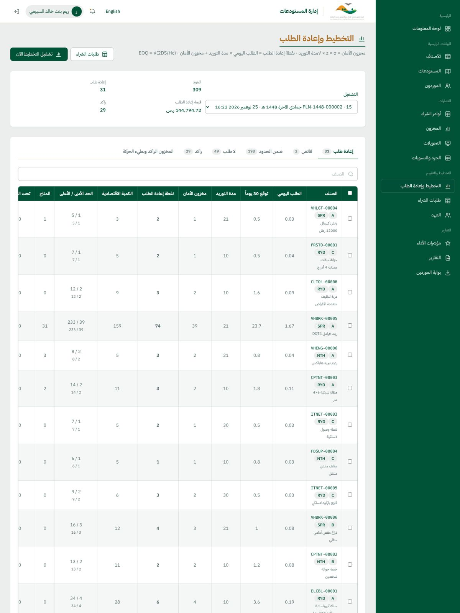
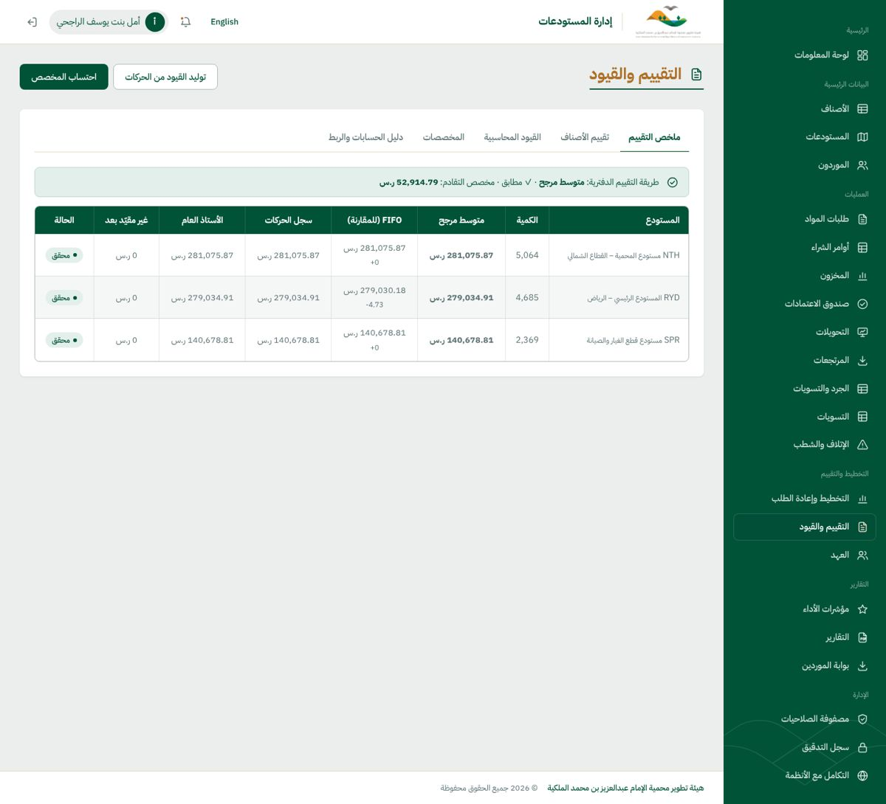
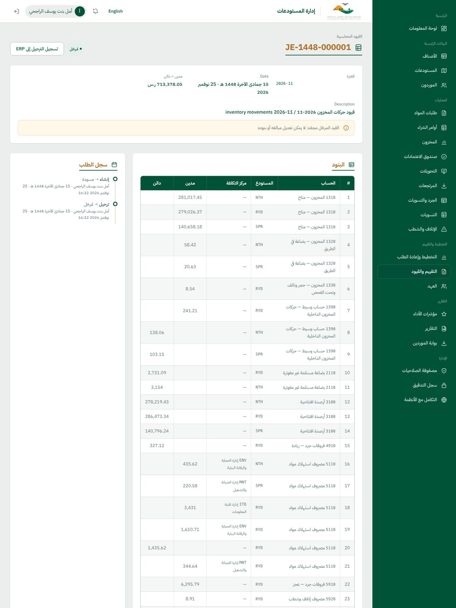
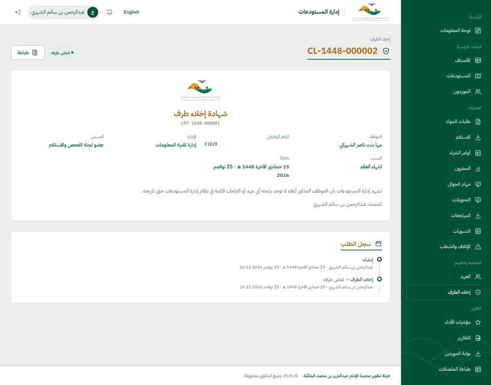
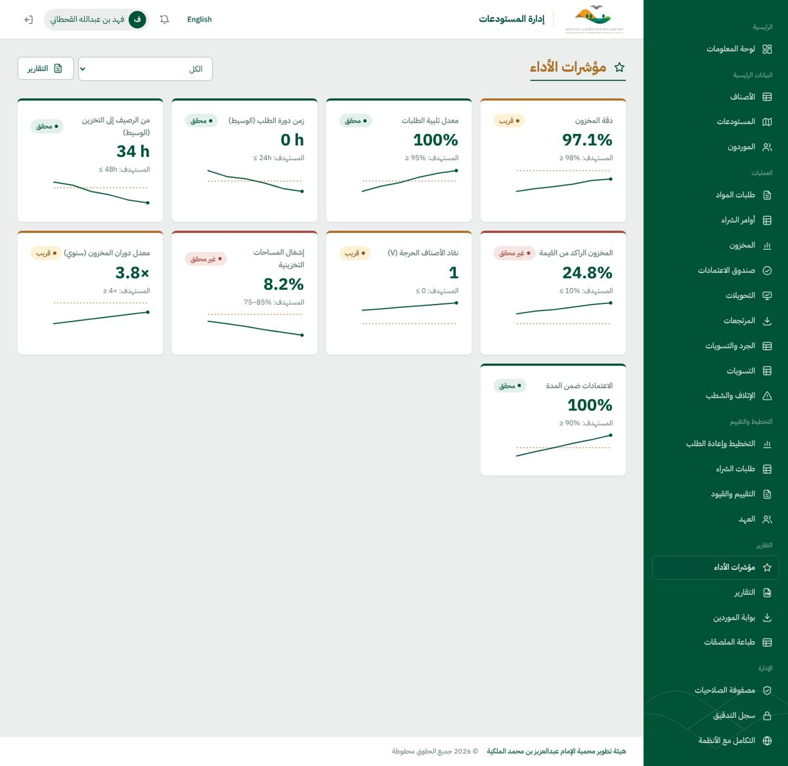
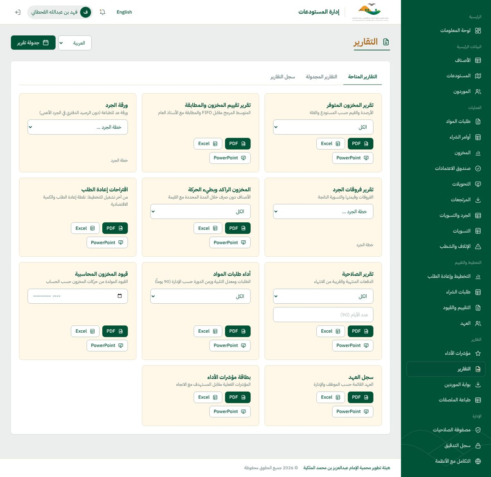
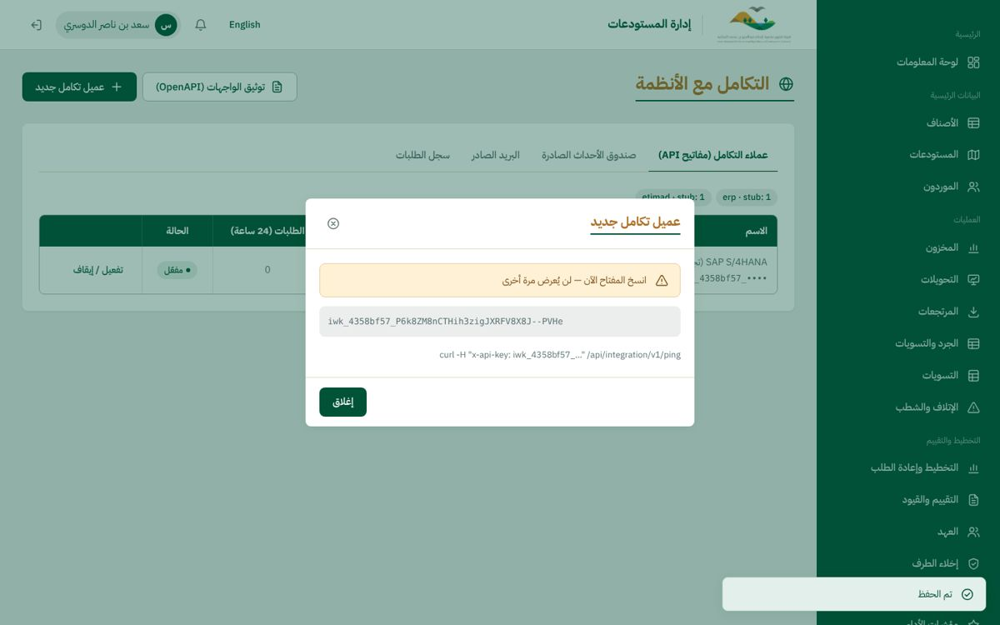

# WMS Phases 4 & 5: Planning, Valuation, Custody, KPIs, Reports & Integrations

Status: **delivered together, awaiting confirmation**. The next step is installation and deployment; see [`06-operations.md`](06-operations.md).

## Phase 4: planning, valuation, assets and custody

### Inventory planning and replenishment (`/planning`)



- **Demand data:**
  - Net issues in the ledger (GI minus returns).
  - The **legacy consumption history** (`consumption_history`), imported at go-live, so planning works from day one.
  - Demand is bucketed into 30-day periods (6 by default).
- **Per item and warehouse, the system computes:**

  | Parameter | Formula |
  |---|---|
  | Daily demand (d) | mean of the 30-day buckets ÷ 30 |
  | Safety stock (SS) | z · σ_d · √LT (z = 1.65, about 95% service level) |
  | Reorder point (ROP) | d · LT + SS |
  | EOQ | √(2·D·S / (H·c)) |
  | Min / max | min = SS, max = ROP + EOQ |
  | 30-day forecast | weighted moving average (0.5 / 0.3 / 0.2) |

  All parameters are in *Settings* (`planning.*`).
- **Recommendation for each line:**
  - **reorder:** free stock plus stock on order is at or below ROP. The suggested quantity tops up to max, and is at least one EOQ.
  - **excess**, **within limits**, **no demand**.
  - **dead:** no issue for 180 days or more. Items never issued count from their first receipt.
- **Apply** writes the computed min, SS, ROP, max and reorder quantity into the item policies; each change is audited.
- **Create requisitions** builds one auto-PR per warehouse and submits it for approval.
- **Nightly runs:** the scheduler runs planning every night. Requisitions are created automatically only when `planning.auto_pr` is on.
- **Dead and slow-moving stock** has its own tab with idle days and value.

### Purchase requisitions (`/planning/prs`)

- **Lifecycle:** draft → DoA approval → approved → **converted to PO** by procurement, with the Etimad award reference and agreed prices.
- **DoA:** warehouse manager; Finance as well above SAR 100,000.
- **SoD:** an approver of the requisition cannot convert it.
- **Etimad:** an approved requisition is queued for Etimad tendering (event `requisition.approved`).
- **Next planning run:** the PR and PO quantities count as *on order*, so the same need is not suggested twice.

### Valuation and journals (`/valuation`)



- **Book value:** weighted average, maintained by the posting engine.
- **FIFO comparison:** shown per warehouse and per item. Remaining stock is matched against the newest cost layers: receipts, opening balances, returns, count gains and transfers in.
- **GL journals generated from the stock ledger:**
  - One draft entry per month.
  - Each ledger row is journalised **exactly once** (`journal_source`).
  - Debit and credit are always equal.

  | Movement | Debit / credit |
  |---|---|
  | GR | Inventory 1310 / GRNI 2110 |
  | GI | Consumption 5110, by **cost center** (the requesting department) / Inventory |
  | ADJ ± | Inventory / count gains 4910 or count losses 5910 |
  | SCRAP | Write-off 5920 / Inventory |
  | RTV | GRNI / Inventory |
  | Internal moves | Through clearing account 1390, which nets to zero |

  The inventory account depends on stock status: available 1310, in transit 1320, quarantine or damaged 1330. All mappings are data (`movement_gl_map`, `status_gl_map`).
- **Posting:** Finance posts the entry, which is then **frozen by a database trigger**. Amounts, lines and the period cannot change after posting.
- **ERP transfer:** a posted journal is queued for the ERP (`journal.posted`). The ERP acknowledges it with its own reference, and the status becomes *exported*.
- **Reconciliation, at all times:** book value = sum of the ledger = GL inventory accounts + movements not yet journalised.
- **Provisions:**
  - Expired and damaged stock: 100%.
  - Quarantine: 25%.
  - Near expiry (90 days or less): 50%.
  - Dead stock: 50%.
  - Slow-moving: 10%.

  The rates are configurable. Each run books **only the difference** against the 1319 balance (Dr 5930 / Cr 1319, or the reverse).



### Assets and custody (`/custody`), employee clearance (`/clearances`)

- **Registration:** delivering a **custody request** registers each serial unit against the requester, with item, serial, value, department and the request number.
- **Holder actions:** the holder **acknowledges** receipt; a reminder is sent if they have not after 3 days. The holder can also start a **return**, which opens a return to warehouse that the storekeeper inspects.
- **Storekeeper actions:** **transfer** to another employee, who must then acknowledge.
- **Loss:** declared by a manager with `custody.approve`. The holder can never confirm their own loss.
- **Clearance (إخلاء طرف):**
  - The system checks for active custody, custody being returned, open material requests, pending approvals and open pick lists.
  - With any of these present, the clearance is **blocked** and lists the reasons; *Re-check* updates it.
  - With none, it is **cleared** and issues a printable certificate (`CRT-…`).
  - An employee cannot process their own clearance.
  - HR can open a clearance through the integration API when an employee leaves.



## Phase 5: KPIs, reports, alerts, integrations and hardening

### KPIs (`/kpis`, and on the dashboard)

All 9 KPIs are computed from transactions, and the targets are in `kpi.targets`:

| KPI | Target |
|---|---|
| Inventory accuracy | ≥ 98% |
| Fill rate | ≥ 95% |
| Request cycle time (median) | ≤ 24 h |
| Dock-to-stock (median) | ≤ 48 h |
| Dead stock (share of value) | ≤ 10% |
| Critical (V) stock-outs | 0 |
| Space utilisation | 75–85% |
| Inventory turnover | ≥ 4× |
| Approvals within SLA | ≥ 90% |

A nightly snapshot (`kpi_snapshot`) feeds the 6-month trend line. The demo seed adds 6 months of history that trends toward today's actual values.



### Reports (`/reports`)

11 reports are rendered through the **IARDA report template** (`reports/`), in Arabic or English, as PDF, Excel or PowerPoint:

- stock on hand
- valuation & reconciliation
- count sheet (no book quantity on blind counts)
- count variance
- dead & slow-moving stock
- reorder suggestions
- expiry
- material-request performance by department
- inventory journal
- custody register
- KPI scorecard

**Access:**
- PDF needs `report.view`.
- Excel and PowerPoint (editable data exports) need `report.export`.
- Restricted reports (valuation, journal, custody) also need Finance or audit rights.

Every generated report is stored encrypted, with its run history.

**Scheduled reports:** daily, weekly or monthly at a set hour (Riyadh time). Recipients get a notification and an e-mail with the download link. The demo seed schedules a weekly KPI scorecard, a monthly valuation for Finance and a daily expiry report.



### Alerts and e-mail

- **Nightly alerts (once per day per topic):**
  - items at or below ROP (to planner and WM)
  - lots expiring within 30 days or already expired
  - critical (V) stock-outs
  - overdue approvals
  - custody not yet acknowledged
- **E-mail:** every notification is also e-mailed using the **IARDA e-mail template**, in the recipient's language. Users can opt out on their profile.
- **Delivery:**
  - With `SMTP_URL` set, messages are sent.
  - Without it, they are kept as *logged* in the outbox; nothing leaves the server.
  - Admins can preview each message.

### Integrations (`/admin/integrations`, API `/api/integration/v1/*`)



- **Machine clients:**
  - Created by the system admin with **scoped API keys** (`x-api-key`).
  - The key is shown once and stored as SHA-256.
  - An optional IP allow-list can be set.
  - Each client acts through its own service user, so audit rows name the integration.
  - Every call is logged.
  - Rate limit: 120 calls per minute per key.

| System | Inbound (they call the WMS) | Outbound events (WMS → them) |
|---|---|---|
| ERP | `GET stock`, `GET journals`, `POST journals/{no}/ack`, `POST purchase-orders` (idempotent on `poNo`) | `journal.posted` |
| Etimad | `GET etimad/requisitions`, `POST etimad/awards` | `requisition.approved` |
| CMMS | `POST cmms/material-requests` (work order → request in the technician's name, submitted to DoA), `GET cmms/material-requests/{ref}` | `materials.issued` |
| HR | `POST hr/exits` → clearance | — |

- **Outbound delivery:**
  - Events go through a **transactional outbox**.
  - The dispatcher POSTs each event, HMAC-SHA256 signed, to `INTEGRATION_<SYSTEM>_URL`.
  - Until an endpoint is configured, events are kept as **stub**, recorded and visible, ready to replay with *Retry*.
- **Documentation:** the full OpenAPI spec is at `/api/docs` (tag *integration*).

### Supplier portal, labels, readiness

- **Supplier portal (`/portal`):** suppliers see only their own deliveries (ASN → receipt → accepted / rejected → GRN) and invoices (amount, 3-way match, status).
- **Labels (`/labels`):**
  - Bin labels as an A4 print sheet of 3 × 8 labels with Code 128 barcodes.
  - **Zebra ZPL** downloads for bins and for lots / serials of a receipt.
- **Readiness probe:** `GET /api/ready` checks that the database is reachable and migrated, for the load balancer or orchestrator.
- **Encrypted backups:**
  - `scripts/backup.sh` and `scripts/restore.sh`: AES-256, checksums and retention.
  - Restore verified: 608 ledger rows restored with an intact audit chain.
  - See [`06-operations.md`](06-operations.md).

## Demo walkthrough (password `Iarda@2026!`)

1. **`planner`:** open *Planning & replenishment*, open the *Reorder* tab, select lines, then *Create requisitions*. *Dead & slow-moving stock* is the last tab.
2. **`wm.assets`:** open *Approvals inbox* and approve the pending requisition. **`proc`** then converts it to a PO from its page.
3. **`fin`:** open *Valuation & journals*: summary (reconciled), item valuation (WAVG vs FIFO), then a journal. *Post*, then *Record transfer to ERP*. Try *Compute provision*.
4. **`req.it`:** open *Custody → My custody* and acknowledge the second asset. **`sk.cleaning`** sees the register, and the blocked clearance of `req.it` with its reasons. **`irc3`**'s clearance is cleared, with a certificate.
5. **`wm.cons`:** open *KPIs*, then *Reports*: download the stock report as PDF and Excel, and run a schedule now.
6. **`admin`:** open *Integrations*, create a client and copy its key. Then, using the key you just copied:

   ```
   curl -H "x-api-key: <the key>" http://localhost:3000/api/integration/v1/stock?warehouseCode=CLN
   ```
7. **`supplier.rowad`:** open *Supplier portal*.

## Tests

`npm run test:api` runs **66 tests**. The 18 new ones cover:
- **Planning:**
  - SS / ROP / EOQ formulas
  - run → apply → auto requisition → approval → PO, and SoD
  - quantities on order counted in the next run
- **Valuation:**
  - FIFO vs WAVG
  - journals balanced, each ledger row journalised once, frozen after posting, reconciled
  - provision books only the delta
- **Custody:**
  - custody request → acknowledgement → return
  - clearance blocked, then cleared
  - transfer and loss with SoD
- **KPIs and reports:**
  - KPI board
  - Excel and PDF rendering
  - export rights
  - schedules and their notification
- **Integrations:**
  - API keys and scopes
  - ERP purchase order in (idempotent) and journals out and acknowledged
  - CMMS work order and HR exit
- **Portal, labels and operations:**
  - supplier portal isolation
  - ZPL labels
  - alert de-duplication and e-mail logging
  - readiness and integrity

## Changes from the approved design

- **FIFO:** shown as a comparative valuation. The book method stays weighted average (`valuation.method`), because switching the book method is a finance policy decision for go-live.
- **Consumption history:** a dedicated import table for legacy history. Ledger dates are never backdated, so the immutable ledger only ever holds real postings.
- **Put-away fix:** suggestions now reserve bin capacity for open put-away tasks. Before this, a multi-line receipt could send every task to the same bin.
- **KPI targets:** the setting moved to a structured form (`{key: {target, dir}}`). Migration 009 converts the Phase 1 values and keeps any edits.
